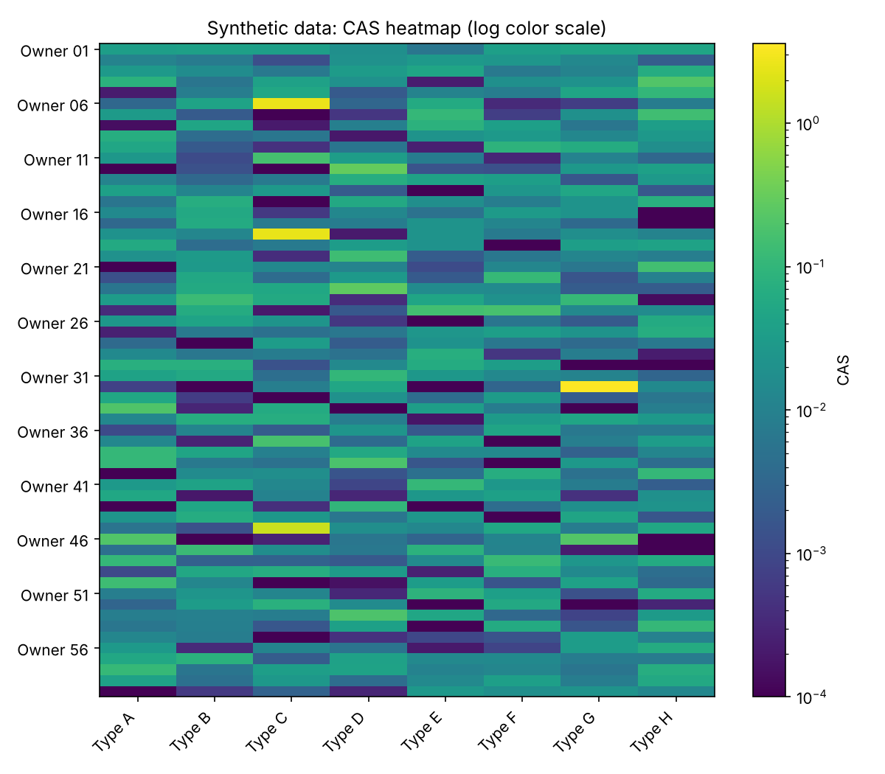
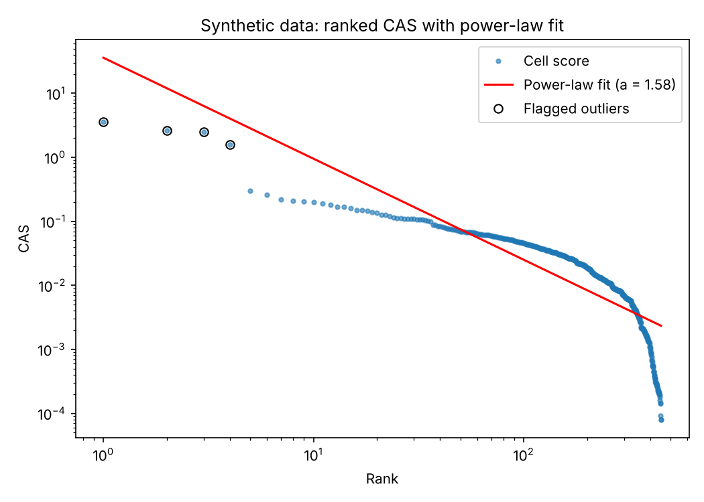

<h1 align="center">Cancellation Anomaly Score</h1>
<p align="center"><i>Finding where service-request cancellations concentrate, and who owns them.</i></p>

<p align="center">
  
</p>

> **Confidentiality note:** This repo recreates a method I developed during a summer 2026 internship at Bank of America. It runs on **randomly generated data only**. No real data, names, volumes, or internal details are included.

## The problem
A shared-services team had thousands of service requests that ended in cancellation. Raw cancellation counts were misleading: a busy owner cancels more simply because they handle more. The question was *where is cancellation unusually concentrated, and is it a person, a request type, or both?*

## The approach
Each cell is one owner handling one request type. The score multiplies three ideas:

```
S_ij = [ c_ij / (c_ij + x_ij) ]  x  [ c_ij / sum_j c_ij ]  x  [ c_ij / sum_i c_ij ]  x  100
          cancel rate               share of the owner's        share of the request type's
                                    cancellations               cancellations
```

where `c` is cancelled requests and `x` is completed requests. A cell scores high only when **all three** are high: the owner cancels this type often, it makes up much of their cancellations, *and* they account for much of that type's cancellations.

1. Build the owner x request-type matrix of cancelled and completed counts.
2. Score every cell and plot a heatmap on a log color scale so small and large scores are both visible.
3. Rank the scores and fit a power law `y = C / rank^a` by least squares on the log-log scale.
4. Flag cells whose log score is a robust outlier (median/MAD z-score above 2.5).

## Demo results (synthetic data)
60 owners x 8 request types, 450 scored cells, 4 planted outlier cells. All 4 were recovered, and nothing else was flagged.

| Flagged cell | CAS |
|---|---|
| Owner 32, Type G | 3.59 |
| Owner 06, Type C | 2.65 |
| Owner 18, Type C | 2.50 |
| Owner 45, Type C | 1.57 |

Fitted power-law exponent on this synthetic data: **a = 1.58**.

<p align="center">
 
</p>

## What the real project delivered
- A CAS analysis across a large set of service requests that flagged a small group of outlier owners concentrated in one request type
- A power-law fit on the ranked scores to separate true outliers from the long tail
- An 11-page findings report, a follow-up survey for root-cause interviews, and a standard operating procedure for management

## Run it
```
pip install -r requirements.txt
python cas_demo.py
```
